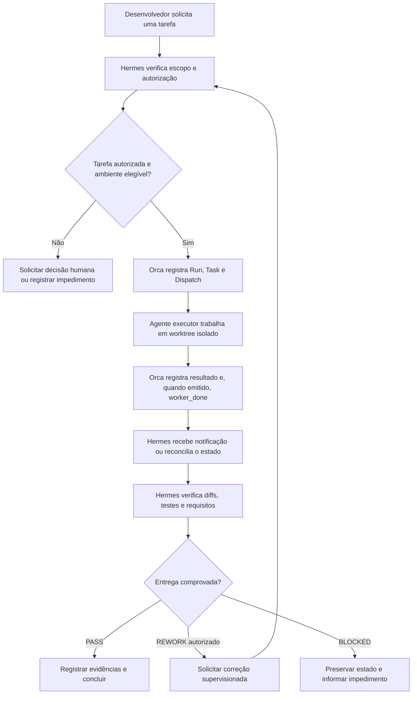

# Orca Supervised Orchestration

**Uma skill para o Hermes Agent delegar tarefas a outros agentes de programação por meio do Orca CLI — e auditar as entregas antes de aceitá-las.**

**Estado:** experimental · **Formato:** skill do Hermes (não é plugin do Orca) · **Licença:** [MIT](LICENSE)

## Qual problema resolve?

Quem utiliza mais de um agente de programação frequentemente precisa distribuir tarefas, acompanhar o que foi feito e verificar se o código entregue realmente atende aos requisitos. Simplesmente encaminhar um prompt para outro agente não comprova que o trabalho foi concluído corretamente.

A **Orca Supervised Orchestration** fornece ao Hermes um procedimento de delegação e supervisão usando a orquestração **nativa do Orca**. O Hermes continua responsável pelas instruções, permissões, validação e decisão de aceite; o agente executor realiza o trabalho no ambiente autorizado.

## Como funciona?



- **Hermes:** interpreta a solicitação, confere o escopo aprovado, delega, acompanha o retorno e audita o resultado.
- **Orca:** oferece os mecanismos nativos de Run, Task, Dispatch e worktrees.
- **Agente executor:** realiza a investigação ou implementação autorizada; um exemplo é o Antigravity quando disponível e configurado no Orca.
- **Desenvolvedor:** decide questões de escopo, confirma gates humanos e aprova ações que exigem autorização específica.

O retorno `worker_done` é um **sinal de conclusão da execução**, não uma prova de qualidade. O Hermes deve conferir os arquivos produzidos, alterações rastreadas e não rastreadas, testes, permissões e critérios da tarefa.

A notificação de conclusão não substitui a revisão. Em caso de falha de entrega do evento, o Hermes consulta o estado persistido pelo Orca antes de tomar qualquer decisão; **não** inicia um segundo worker por silêncio.

Para ver as mensagens e o fluxo de recuperação, consulte [Comunicação e eventos](docs/WORKFLOW.md) e [Recuperação](docs/RECOVERY.md).

## Exemplo de uso

Um desenvolvedor solicita ao Hermes:

> Investigue um bug no meu projeto. Use o Orca para delegar a análise a um agente compatível em um worktree isolado. Não altere arquivos sem autorização. Depois, confira as evidências e me apresente o diagnóstico.

Após a autorização e o preflight, o Hermes pode preparar um Run e um Dispatch no Orca, acompanhar o resultado do worker e revisar o material antes de aceitar ou solicitar correções.

**Essa skill não é um atalho para usar credenciais de um fornecedor em outro.** Ela utiliza mecanismos de orquestração disponíveis no ambiente configurado; o acesso a cada agente continua sujeito às regras, aos limites, às permissões e aos termos do respectivo fornecedor. **Não há garantia de que qualquer integração seja permitida em todos os planos, nem de ausência de bloqueio de conta.**

## O que a skill oferece?

- Delegação supervisionada usando a CLI nativa do Orca, sem criar um orquestrador paralelo.
- Trabalho em worktrees isolados, com **WIP=1** e verificação de escopo autorizado.
- Correlação de Run/Task/Dispatch e verificação das entregas do worker.
- Tratamento explícito de falhas, estados incertos e bloqueios de confiança do workspace.
- Revisão de evidências antes de declarar uma tarefa `PASS`, `PARTIAL` ou `BLOCKED`.

Ela **não** instala ou fornece Hermes, Orca, Antigravity, modelos, contas, tokens ou cotas. Também não cria plugin nativo do Orca, daemon, servidor, scheduler, dashboard ou Kanban próprio; não concede permissões para push, merge, deploy, acesso a banco produtivo ou contorno de controles de segurança.

## Instalação inicial

**Pré-requisitos:** Hermes Agent com suporte a skills; Orca CLI instalado, configurado e acessível pelo Hermes; Git; e ao menos um agente executor disponível e autorizado no Orca.

Exemplo de instalação manual em **Linux/WSL**, partindo de uma instalação já funcional do Hermes:

```sh
git clone https://github.com/AndrewDevos1/orca-supervised-orchestration.git
cd orca-supervised-orchestration
mkdir -p ~/.hermes/skills/autonomous-ai-agents/orca-supervised-orchestration
cp SKILL.md ~/.hermes/skills/autonomous-ai-agents/orca-supervised-orchestration/SKILL.md
```

Abra uma nova sessão do Hermes para carregar a skill. **Antes de sobrescrever uma instalação anterior, compare o conteúdo e o hash** conforme [INSTALL.md](INSTALL.md).

Verifique a conectividade e os recursos efetivamente disponíveis:

```sh
orca status --json
orca repo list --json
orca skills get orchestration
```

Esses comandos verificam pré-requisitos; **não** comprovam, por si sós, que um worker pode executar no seu workspace. Confirme permissões, confiança e suporte do agente no seu ambiente. Veja [INSTALL.md](INSTALL.md) e [USAGE.md](USAGE.md) para o procedimento completo.

## Quando for necessária intervenção humana

Se o Orca indicar `agent-trust-workspace`, o Hermes deve mostrar **o caminho exato** e a confirmação necessária no aplicativo oficial. Depois de uma resposta como “pronto”, ele **verifica novamente o estado nativo** antes de retomar. A resposta do usuário não substitui a confirmação técnica. Não é permitido contornar confiança, autenticação ou criar um worker duplicado por timeout.

## Estado e limitações

A distribuição é **experimental**. A documentação foi elaborada com referência ao Orca CLI `1.4.248` em um cenário Linux/WSL com runtime Orca alcançável. Os testes documentados não demonstram compatibilidade universal, entrega automática de wake em todos os cenários, recuperação autônoma de qualquer falha de transporte ou execução em todos os sistemas.

A ajuda da **versão efetivamente instalada** da CLI prevalece sobre exemplos deste README. Veja [Validação T0–T4](docs/VALIDATION-T0-T4.md).

## Documentação

- [Instalação](INSTALL.md) · [Uso](USAGE.md) · [Casos de uso](USE-CASES.md)
- [Arquitetura](docs/ARCHITECTURE.md) · [Workflow](docs/WORKFLOW.md)
- [Recuperação](docs/RECOVERY.md) · [Solução de problemas](docs/TROUBLESHOOTING.md)
- [Validação](docs/VALIDATION-T0-T4.md) · [Manutenção](docs/MAINTENANCE.md) · [Versionamento](docs/VERSIONING.md)
- [Contribuição](CONTRIBUTING.md) · [Segurança](SECURITY.md) · [Código de conduta](CODE_OF_CONDUCT.md)

## Licença e autoria

Código e documentação **deste repositório**: [MIT](LICENSE), Copyright (c) 2026 AndrewDevos1. A licença não se estende a Hermes, Orca, Antigravity, modelos ou dependências de terceiros, que têm seus próprios termos.

**Futuro possível:** avaliar um plugin nativo do Orca como iniciativa separada, sem confundi-lo com a skill atual do Hermes.
