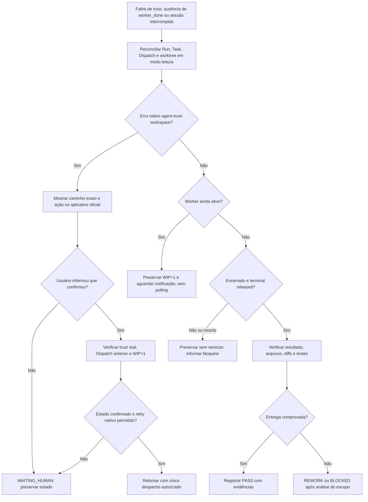

# Recuperação

Após perda de terminal/sessão, reconcilie antes de agir:

```sh
orca status --json
orca orchestration run-list --json
orca orchestration worker-list --json
orca worktree ps --json
orca orchestration worker-show --dispatch <dispatch-id> --json
```

- `exited` + `released`: histórico encerrado; não reinicie automaticamente.
- `unverifiable` ou `retained`: estado desconhecido; preserve, não duplique nem libere sem decisão.
- `agent-trust-workspace`: gate pré-execução; peça confirmação oficial para o path visível.

Registre IDs, `stage`, `lastError`, worktree, HEAD, status e arquivos não rastreados. Não resetar, remover worktree, matar terminal ou repetir worker por silêncio.

## Fluxograma de recuperação segura

O diagrama representa **decisões de supervisão**, não comandos de bypass ou um mecanismo de retomada automática garantido.



### Intervenção humana assistida

Quando o gate nativo for `agent-trust-workspace`, o Hermes deve apresentar o **caminho exato visível ao aplicativo**, o motivo, a ação oficial necessária e, quando disponível, um link/comando de abertura comprovado. O usuário confere a pasta e só então escolhe a opção de confiança no aplicativo. Responder `pronto`, `feito` ou `confiado` **apenas solicita nova verificação do estado**, não concede trust automaticamente.

Após a confirmação, consultar o estado real e os identificadores do Dispatch anterior. Só fazer um novo despacho ou um retry nativo se a situação estiver reconciliada, o comando for permitido pela CLI efetivamente instalada e não existir executor concorrente. Nunca alterar configurações de confiança, mascarar erro ou migrar de workspace para evitar o gate.

### Sem resposta ou sem notificação

Se o `worker_done` não chegar, não assumir que o worker parou. Diferencie processo ativo, `exited/released` e `unverifiable/retained`; preserve worktree, IDs, status e evidências. Uma consulta manual ao estado **não comprova** que a notificação automática funcionou.
